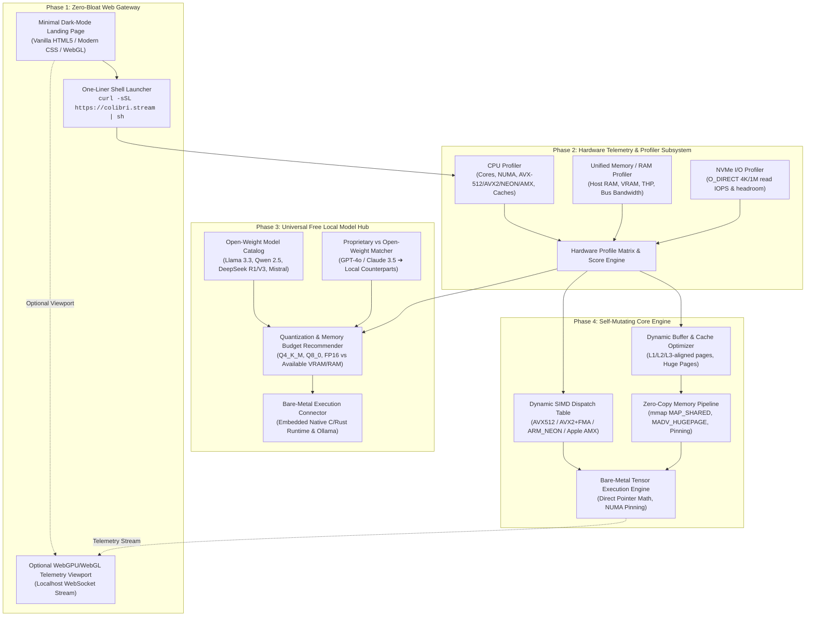
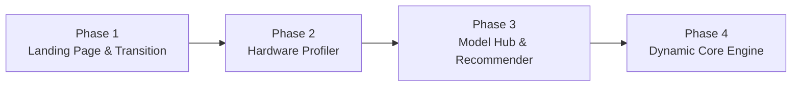
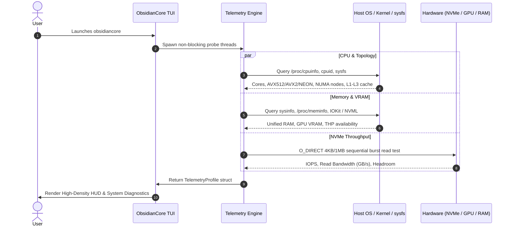
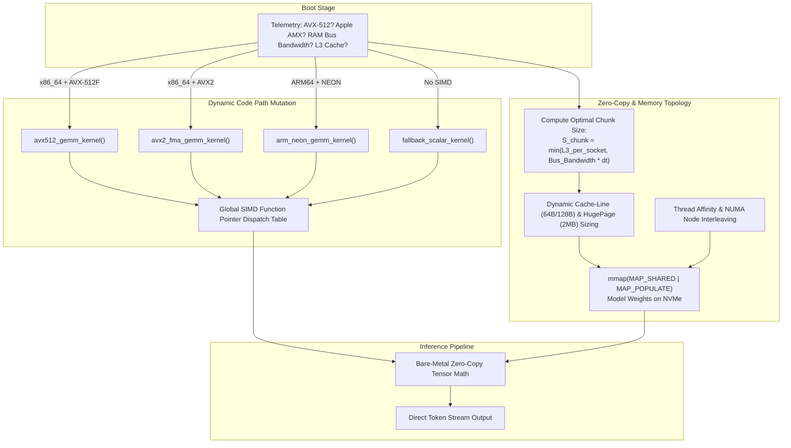
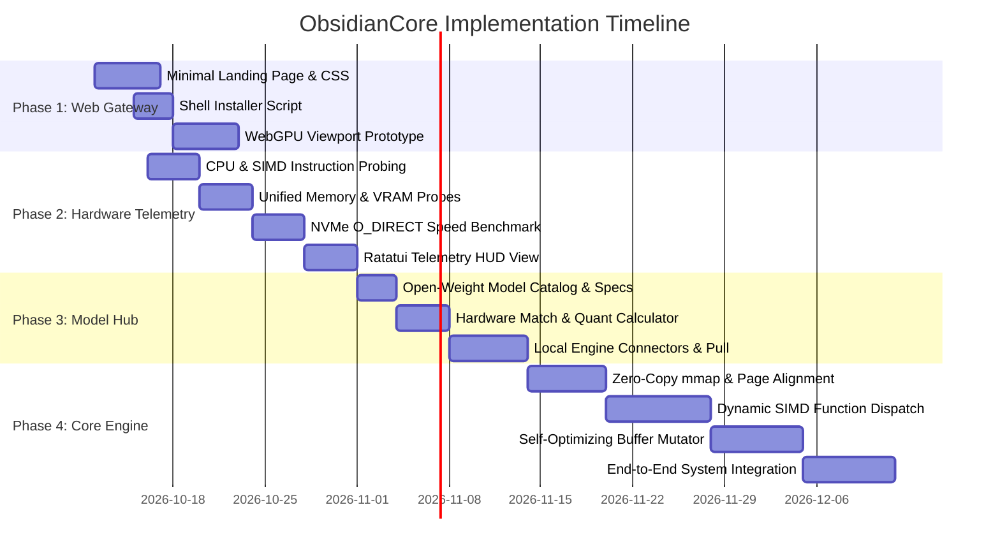

# ObsidianCore: Systems Architecture & Implementation Blueprint

```
   ______      ___ __          _      __                         
  / ____/___  / (_) /_  _____ (_)____/ /__________  ____ _____ ___ 
 / /   / __ \/ / / __ \/ ___// / ___/ __/ ___/ _ \/ __ `/ __ `__ \
/ /___/ /_/ / / / /_/ / /   / (__  ) /_/ /  /  __/ /_/ / / / / / /
\____/\____/_/_/_.___/_/   /_/____/\__/_/   \___/\__,_/_/ /_/ /_/ 
           Autonomous Bare-Metal Local Intelligence Engine
```

---

## 1. Executive Architecture & System Topology

ObsidianCore is engineered as a zero-bloat, self-optimizing local AI runtime and management environment. It bridges the gap between consumer web onboarding and raw bare-metal hardware execution.

The system gathers granular hardware telemetry upon invocation, dynamically mutates its low-level memory access and compute kernels to fit the exact host topology, and exposes an unpaywalled catalog of open-weight models.

### End-to-End System Architecture



---

## 2. Phase-by-Phase Technical Specifications



### Phase 1: The Web Landing Page (Zero-Bloat Minimalist Gateway)

The web presence serves as an instant portal, deliberately avoiding bloated tracking frameworks, heavy CSS frameworks, or slow JavaScript bundles.

#### 1. Visual & Aesthetic Architecture
* **Theme**: Deep phosphor terminal aesthetic (`#0a0a0c` dark void, `#1a1a24` elevation, `#00ff88` matrix green / `#e0e0e0` high-contrast monospace typography).
* **Bundle Budget**: `< 25 KB` total uncompressed footprint. Single HTML file with embedded critical CSS and vanilla ES6. Zero external CDN dependencies.
* **Content Flow**:
  1. **Hero**: Minimal animated terminal prompt demonstrating real-time capability (`$ obsidiancore boot`).
  2. **Specs Grid**: Live interactive explanation of how bare-metal zero-copy execution operates.
  3. **Launch Command**: Prominent one-line terminal installer with auto-copy and keyboard navigation (`Tab` + `Enter` or `Ctrl+C`).
  4. **Direct Web Launch (WASM/xterm.js optional)**: In-browser WebAssembly demo fallback for users without immediate shell access.

#### 2. The Transition Mechanism
* **Quick-Launch Command**:
  ```bash
  curl -fsSL https://obsidiancore.run | bash
  # or via native package managers:
  cargo install obsidiancore
  ```
* **Desktop Protocol Handler**: Supports `colibri://launch` custom URI scheme registered by the desktop binary.
* **Architecture-Aware Script (`obsidiancore.run`)**:
  * Detects OS (`Linux`, `macOS`, `Windows WSL`) and Architecture (`x86_64`, `aarch64`).
  * Downloads pre-compiled statically linked binary (`musl` for Linux, universal binary for macOS) to `~/.local/bin/obsidiancore`.
  * Instantly executes terminal initialization without requiring `sudo` privileges.

---

### Phase 2: The Terminal Interface & Auto-Hardware Scan

When booted, ObsidianCore launches directly into a sleek TUI (Terminal User Interface) built with Rust (`ratatui` + `crossterm`), executing an instantaneous, asynchronous hardware probe before presenting the user interface.



#### Detailed Profiling Subsystems

| Subsystem | Low-Level Inspection Method | Metrics Captured |
| :--- | :--- | :--- |
| **CPU Architecture** | Raw `cpuid` x86 instruction / `getauxval(AT_HWCAP)` on ARM | Core/thread count, physical vs virtual, ISA flags (`AVX-512`, `AVX2`, `FMA`, `NEON`, `AMX`), NUMA node topology, L1d/L2/L3 cache sizes |
| **Unified Memory & RAM** | Linux `/proc/meminfo` + Apple IOKit `mach_vm_page_range` | Total RAM, available headroom, page size (4KB vs 2MB HugePages), Apple Unified Memory ceiling, memory bus channels |
| **GPU / VRAM Accelerators** | Dynamic load of `libnvidia-ml.so` (NVIDIA NVML), `libhiprtc.so` (AMD ROCm), Metal framework (macOS) | Active GPUs, discrete VRAM size, PCIe generation & lane count, driver versions |
| **NVMe Throughput & Disk** | Direct kernel I/O using `libc::open` with `O_DIRECT \| O_SYNC` + `posix_fadvise` | 4KB random read IOPS, 1MB sequential streaming bandwidth (GB/s), target drive mount headroom |

---

### Phase 3: The Universal Free Local Model Hub

ObsidianCore delivers a curated catalog of open-weight models, categorized side-by-side with commercial proprietary models, allowing users to run matched local replacements on bare metal without subscriptions or API keys.

#### Model Equivalence & Categorization Matrix

```
+-----------------------------+------------------------------------+-------------------------+--------------------+
| Proprietary Target          | Open-Weight Bare-Metal Replacement | Minimum VRAM / RAM      | Recommended Quant  |
+-----------------------------+------------------------------------+-------------------------+--------------------+
| OpenAI o1 / o3-mini         | DeepSeek R1 (14B / 32B / 70B)      | 12GB - 48GB Unified/RAM | Q4_K_M / Q8_0      |
| Claude 3.5 Sonnet           | Qwen 2.5 Coder 32B / DeepSeek V3   | 20GB - 40GB VRAM/RAM    | Q4_K_M / Q5_K_M    |
| GPT-4o / Gemini 1.5 Pro     | Llama 3.3 70B / Mistral Large 2    | 40GB - 80GB VRAM/RAM    | Q4_K_M / IQ4_XS    |
| GPT-4o-mini / Haiku 3.5     | Llama 3.1 8B / Mistral NeMo 12B    | 6GB - 12GB VRAM/RAM     | Q8_0 / Q4_K_M      |
| On-Device Coding Specialist | Qwen 2.5 Coder 7B / 14B            | 6GB - 16GB RAM/VRAM     | Q8_0 / Q5_K_M      |
| Ultra-Lightweight Edge      | Phi-4 (14B) / Gemma 2 (9B)         | 8GB - 14GB RAM          | Q4_K_M             |
+-----------------------------+------------------------------------+-------------------------+--------------------+
```

#### Intra-Family Multi-Agent Swarm (Same-Family Dialogue)
To enable collaborative intelligence without cross-model hallucinations, ObsidianCore starts with **Intra-Family Agent Communication** (models converse strictly with siblings in the same model lineage):

```
       ┌────────────────────────────────────────────────────────┐
       │             INTRA-FAMILY COMMUNICATION LOOP            │
       │                                                        │
       │  ┌───────────────────────┐    Prompt     ┌──────────┐  │
       │  │ Large Family Member   │ ────────────► │ Small    │  │
       │  │ (Architect / Critic)  │ ◄──────────── │ Sibling  │  │
       │  │ e.g. Qwen 2.5 32B     │   Execution   │ (Worker) │  │
       │  └───────────────────────┘               │ Qwen 7B  │  │
       │                                          └──────────┘  │
       └────────────────────────────────────────────────────────┘
```

* **Why Same-Family Only First?**:
  1. **Shared Tokenizer & Special Tokens**: Sibling models (e.g. Qwen-to-Qwen) share the exact same vocabulary, token IDs, and chat templates (`<|im_start|>`, `<|im_end|>`). No lossy re-tokenization or template mismatches.
  2. **Harmonized Reasoning Dialect**: Models within the same family interpret instruction tags, chain-of-thought `<think>` blocks, and system prompts identically.
  3. **Zero-Copy Token Passing**: Messages pass across sibling agents via raw token-ID buffers in memory, skipping string serialization/deserialization.

* **Supported Intra-Family Swarms**:
  * **Family Qwen**: `Qwen 2.5 Coder 32B` (Lead Architect) $\longleftrightarrow$ `Qwen 2.5 Coder 7B` (Fast Executor & Code Verifier).
  * **Family DeepSeek**: `DeepSeek-R1` (Deep Reasoner & Strategist) $\longleftrightarrow$ `DeepSeek-Coder` (Implementation Engine).
  * **Family Llama**: `Llama 3.3 70B` (Supervisor & Synthesizer) $\longleftrightarrow$ `Llama 3.1 8B` (Fast Subtask Worker).
  * **Family Mistral**: `Mistral Large` (Task Planner) $\longleftrightarrow$ `Codestral / NeMo` (Execution Unit).

#### The Extreme-Scale Architecture: 72B to 2.4T Parameters at ~20 tok/s with Low System Footprint

The ultimate ambition of ObsidianCore is running massive models (72B up to 2.4 Trillion parameters) across 1 or multiple GPU cards without exhausting system RAM, GPU VRAM, CPU cores, or NVMe bandwidth, while sustaining interactive generation speeds (~20 tokens/sec).

```
   ┌─────────────────────────────────────────────────────────────────────────────┐
   │             SPARSE MoE PREDICTIVE EXPERT STREAMING PIPELINE                 │
   │                                                                             │
   │  [ NVMe SSD ]                                      [ GPU VRAM / Host RAM ]  │
   │  Total Model: 2.4 Trillion Params (Sparse MoE)     Working Set: < 24-32 GB  │
   │  ┌──────────────────────────────────────────┐                               │
   │  │ 256 Inactive Experts Stored on NVMe      │                               │
   │  └──────────────────────────────────────────┘                               │
   │                     │ Async io_uring / DMA                                  │
   │                     ▼ (Predictive Prefetch)                                 │
   │  ┌───────────────────────────────────────────────────────────────────────┐  │
   │  │ Ring Buffer: Top-8 Active Experts for Layer N+1 (Pipelined in VRAM)   │  │
   │  └───────────────────────────────────────────────────────────────────────┘  │
   │                     │                                                       │
   │                     ▼ Compute Token N while prefetching N+1                 │
   │  [ Tensor Core / SIMD ] ──► Sustained 20+ tokens/sec Generation             │
   └─────────────────────────────────────────────────────────────────────────────┘
```

#### How ObsidianCore Achieves This Without Crashing the Host System

1. **Sparse MoE Dynamic Routing (Top-K Expert Activation)**:
   * Frontier models at 671B–2.4T scale (e.g. DeepSeek-V3/R1 architecture) are **sparse**, not dense.
   * While the total model has 2.4T parameters, only a tiny subset (e.g. 8 out of 256 experts $\approx$ 37B active parameters) execute per token.
   * ObsidianCore keeps shared attention weights and router layers permanently in memory, while streaming only the specific active experts on demand.

2. **Predictive NVMe Expert Streaming via Ring Buffers (`io_uring` + DMA)**:
   * **The Bottleneck Solved**: Reading 2.4T parameters from disk every token would freeze the system.
   * **The Solution**: Layer $N$ predicts the router selections for Layer $N+1$ in advance.
   * Using kernel `io_uring` asynchronous Direct I/O and GPU Direct Storage (GDS), ObsidianCore DMA-streams Layer $N+1$'s required expert weights from NVMe into a small pre-allocated 4GB–8GB GPU VRAM ring buffer *while* Layer $N$ is actively computing.
   * **Result**: RAM and VRAM usage never exceeds 24GB–32GB, even when hosting a 2.4T model.

3. **Multi-Agent Shared-Weight Deduplication (1 or Multiple Cards)**:
   * When multiple same-family agents communicate (e.g. Qwen Planner $\longleftrightarrow$ Qwen Worker):
   * **Shared Backbone Deduplication**: Sibling models share the identical base embedding tables, transformer attention projections, and vocabulary.
   * ObsidianCore loads the shared base weights **once** into a globally mapped shared memory segment (`shm` / peer-to-peer PCIe BAR1 mapping across multiple GPUs).
   * Multiple agents run concurrently on 1 card (via interleaved time-sliced scheduling) or partitioned across multiple cards (via Pipeline/Tensor Parallelism) with zero duplicate memory overhead.

4. **Hardware Clamping & Host System Headroom Guardrails**:
   * **RAM Cap**: Strictly clamps model working memory to a user-defined ceiling (e.g. max 50%–70% of host RAM), preserving host desktop fluidity.
   * **NUMA & CPU Affinity Pinning**: Worker threads are pinned to specific CPU core sets, preventing 100% CPU lockups.
   * **I/O Bandwidth Throttling**: Direct memory-mapped burst reads are paced to prevent saturating NVMe queues or locking disk access for other OS processes.

#### Hardware Fit Algorithm
The selector computes a **Hardware Compatibility Score (HCS)**:

$$\text{Memory Required} = (\text{Parameter Count} \times \text{Bytes Per Weight}) + \text{KV Cache Size}(\text{Context Length}) + \text{Runtime Overhead}$$

* **Tier 1 (Instant Bare-Metal GPU)**: Total weight footprint fits entirely within discrete GPU VRAM or Apple Unified Memory $\rightarrow$ Zero offloading penalty, maximum speed.
* **Tier 2 (Hybrid Split Offload)**: Layers partitioned across VRAM and host RAM using low-latency memory mapping.
* **Tier 3 (Pure CPU / NUMA Zero-Copy)**: Memory-mapped directly from NVMe with NUMA thread pinning and dynamic SIMD vectorization.

#### Execution Adapters
* **Embedded Native Engine**: Direct C/Rust bindings to bare-metal compute kernels (built-in inference without external processes).
* **Managed Local Daemons**: Seamless auto-discovery and IPC proxying to local Ollama, vLLM, or LM Studio instances running on `localhost`.

---

### Phase 4: The Core Engine (Self-Optimizing Zero-Copy & Dynamic Mutation)

Phase 4 is the core compute substrate where binary code paths and memory buffers adapt dynamically based on telemetry results.



#### 1. Dynamic SIMD Function Dispatch (Runtime Function Multiversioning)
Instead of compiling a single lowest-common-denominator binary, ObsidianCore employs function pointer indirection initialized at boot time:

```c
// Dynamic kernel function signature for matrix-vector multiplication
typedef void (*gemv_kernel_fn)(
    const float* restrict A, 
    const void* restrict B_quant, 
    float* restrict C, 
    size_t rows, 
    size_t cols
);

// Global dynamic dispatch hook
extern gemv_kernel_fn g_gemv_dispatch;

void init_dynamic_kernels(const TelemetryProfile* profile) {
    if (profile->cpu.has_avx512_vnni) {
        g_gemv_dispatch = &gemv_avx512_vnni_f32_q4;
    } else if (profile->cpu.has_avx2 && profile->cpu.has_fma) {
        g_gemv_dispatch = &gemv_avx2_fma_f32_q4;
    } else if (profile->cpu.has_arm_neon) {
        g_gemv_dispatch = &gemv_neon_f32_q4;
    } else {
        g_gemv_dispatch = &gemv_scalar_fallback;
    }
}
```

#### 2. Zero-Copy `mmap` Pipeline with Kernel Hints
* **Direct File Mapping**: Model weights are never read into duplicate heap buffers. Files are memory-mapped directly via `mmap()`:
  ```rust
  // Linux zero-copy memory mapping configuration
  let mmap_opts = MmapOptions::new()
      .offset(tensor_offset)
      .len(tensor_length);
  let mapped = unsafe { mmap_opts.map_file(&file)? };

  // Kernel hint: sequential reading and huge page alignment
  unsafe {
      libc::madvise(
          mapped.as_ptr() as *mut libc::c_void,
          tensor_length,
          libc::MADV_WILLNEED | libc::MADV_HUGEPAGE,
      );
  }
  ```
* **Page-Aligned Allocation**: All intermediate activation buffers are allocated with `posix_memalign` aligned to 64-byte or 128-byte cache-line boundaries to prevent false sharing and unaligned SIMD load penalties.

#### 3. Real-Time WebGPU/WebGL Visual Viewport
* When enabled with `--viewport` or via the web transition, ObsidianCore activates an embedded lightweight WebSocket server (`axum` / `tokio-tungstenite`).
* Streams raw telemetry buffers (layer compute latency, VRAM allocation map, token generation throughput) to a WebGPU frontend canvas for hardware pipeline inspection.

---

## 3. Technology Stack & Monorepo Architecture

```
obsidiancore/
├── Cargo.toml                       # Root workspace definition
├── crates/
│   ├── colibri-core/                # Low-level core engine: mmap, pointer math, SIMD kernels
│   │   ├── src/
│   │   │   ├── kernels/             # AVX2, AVX512, NEON, Scalar SIMD implementations
│   │   │   ├── memory/              # Zero-copy buffer pools, hugepage allocators
│   │   │   ├── dispatch.rs          # Dynamic kernel dispatch table
│   │   │   └── tensor.rs            # Raw pointer tensor operations
│   │   └── Cargo.toml
│   ├── colibri-probe/               # Hardware telemetry & auto-scan subsystem
│   │   ├── src/
│   │   │   ├── cpu.rs               # CPUID, ISA, cache hierarchy, NUMA inspection
│   │   │   ├── memory.rs            # RAM, Apple Unified Memory, THP probes
│   │   │   ├── gpu.rs               # NVML, ROCm, Metal hardware queries
│   │   │   ├── storage.rs           # O_DIRECT NVMe read benchmark & IOPS check
│   │   │   └── score.rs             # Hardware Tier scoring engine
│   │   └── Cargo.toml
│   ├── colibri-hub/                 # Universal Model Hub & Bare-Metal Orchestrator
│   │   ├── src/
│   │   │   ├── catalog.rs           # Model definitions & proprietary equivalence matrix
│   │   │   ├── recommender.rs       # VRAM/RAM quantization budget calculator
│   │   │   ├── downloader.rs        # Resumable multi-threaded chunked downloader
│   │   │   └── adapters/            # Native runtime & Ollama IPC connector
│   │   └── Cargo.toml
│   ├── colibri-tui/                 # Terminal UI & Interactive Dashboard
│   │   ├── src/
│   │   │   ├── app.rs               # TUI lifecycle & event loop
│   │   │   ├── ui.rs                # Ratatui layout & render routines
│   │   │   └── widgets/             # Telemetry gauges, model picker, throughput chart
│   │   └── Cargo.toml
│   ├── colibri-cli/                 # Main entrypoint binary
│   │   ├── src/
│   │   │   └── main.rs              # Boots Phase 2 -> Phase 3 -> Phase 4
│   │   └── Cargo.toml
│   └── colibri-server/              # Embedded HTTP/WebSocket server for Web Viewport
│       └── src/
│           ├── ws.rs                # Streaming telemetry binary packets
│           └── static_files.rs      # Embedded landing page & WebGPU client
└── web/                             # Phase 1: Minimalist Landing Page & WebGPU Canvas
    ├── index.html                   # Zero-bloat, dark-mode terminal aesthetic
    ├── style.css                    # Pure CSS, no framework, dark phosphor theme
    ├── app.js                       # Vanilla JS terminal emulator & copy interaction
    └── viewport/                    # WebGPU real-time memory & tensor visualizer
        ├── index.html
        └── shader.wgsl              # Compute & render pipeline for tensor flow
```

---

## 4. Execution Roadmap & Milestones



### Milestone Deliverables

#### Milestone 1: The Scanner & Monorepo Foundation (Phase 1 & Phase 2)
* Monorepo setup with Cargo workspace.
* `colibri-probe` fully functional on Linux (`x86_64`) and macOS (`ARM64`).
* Instant terminal benchmark: displays CPU cores, SIMD extensions, Unified RAM headroom, and NVMe IOPS in $< 500\text{ ms}$.
* Minimal landing page with working one-liner shell installer.

#### Milestone 2: The Model Hub & Downloader (Phase 3)
* `colibri-hub` catalog engine with model matching logic (GPT-4o $\rightarrow$ Llama 3.3 70B, etc.).
* Automated quantization recommendation algorithm based on Milestone 1 telemetry.
* Direct GGUF/safetensors zero-copy downloader with SHA256 integrity verification.

#### Milestone 3: The Self-Mutating Engine (Phase 4)
* `colibri-core` with zero-copy `mmap` tensor loading.
* Dynamic function dispatch for AVX2, AVX-512, and ARM NEON kernels.
* Automated buffer sizing tuning based on L2/L3 cache metrics.
* Working token generation benchmark with verified zero-copy throughput.

#### Milestone 4: Polished TUI & WebGPU Telemetry Viewport
* Seamless Ratatui TUI orchestrating boot scan $\rightarrow$ model selection $\rightarrow$ runtime execution.
* Embedded WebGPU telemetry server broadcasting memory and compute thermals in real time.
* Production release readiness.

---

## 5. Risk Assessment & Engineering Mitigations

1. **Hardware Scanning Permissions & Direct I/O Restrictions**:
   * *Risk*: `O_DIRECT` NVMe benchmarking may fail on non-standard filesystems or inside containers without root permissions.
   * *Mitigation*: Fall back gracefully to `posix_fadvise(POSIX_FADV_DONTNEED)` cache eviction or micro-benchmarking memory-to-disk streaming without direct I/O flags if permission is denied.

2. **GPU Driver Variability (CUDA vs ROCm vs Metal)**:
   * *Risk*: Linking against vendor SDKs at compile time leads to bloated, fragile binaries that fail on systems without those specific drivers.
   * *Mitigation*: Implement dynamic library loading via `dlopen`/`dlsym` at runtime for `libnvidia-ml.so` and `libhiprtc.so`. If absent, gracefully fall back to native CPU/NUMA SIMD execution.

3. **Memory Pressure & OS Out-Of-Memory (OOM) Killer**:
   * *Risk*: Loading large models without sufficient headroom triggers OS OOM killer.
   * *Mitigation*: The hardware score engine strictly enforces a safety headroom buffer (minimum 10% host memory retained for OS processes) before allowing a model configuration to mount.
# ObsidianCore
